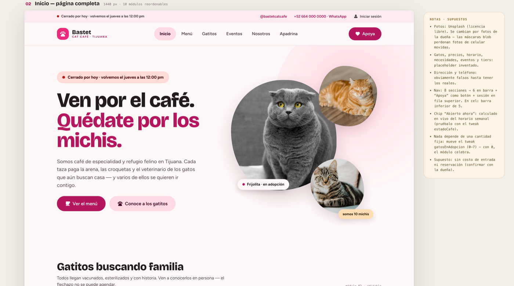
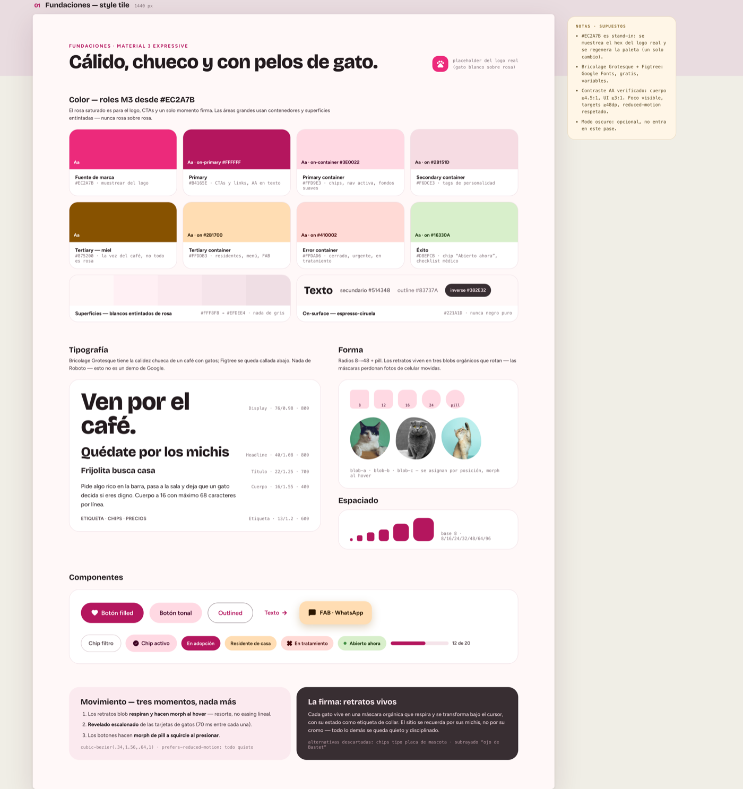
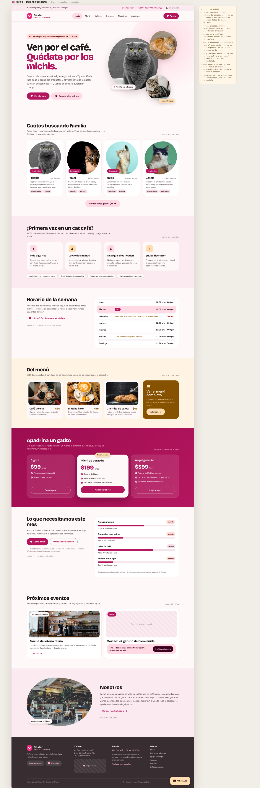
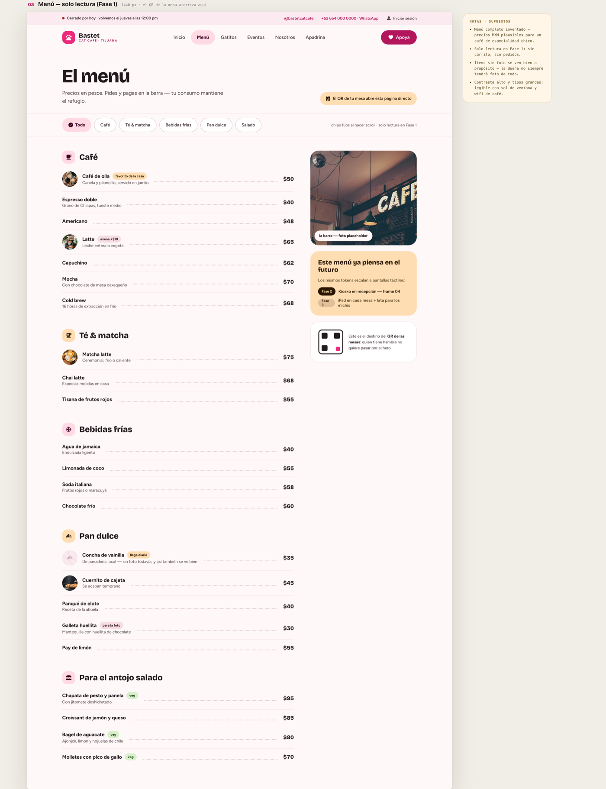
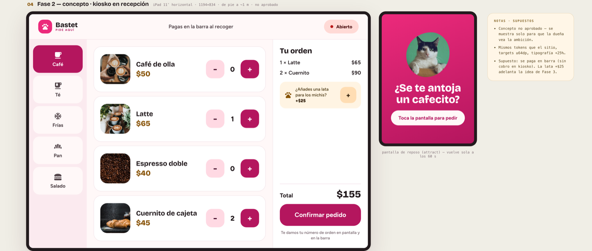
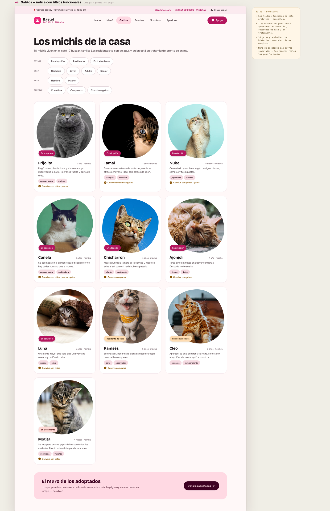
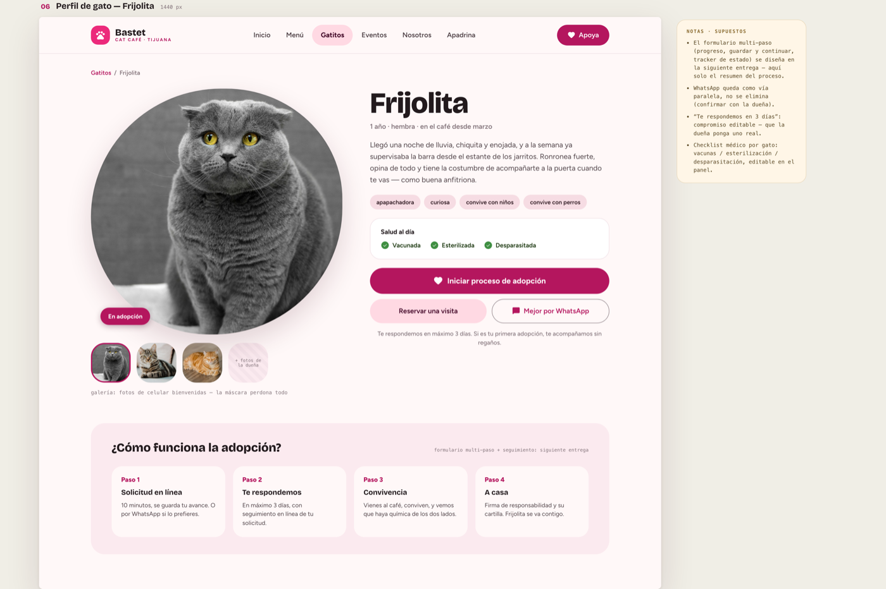
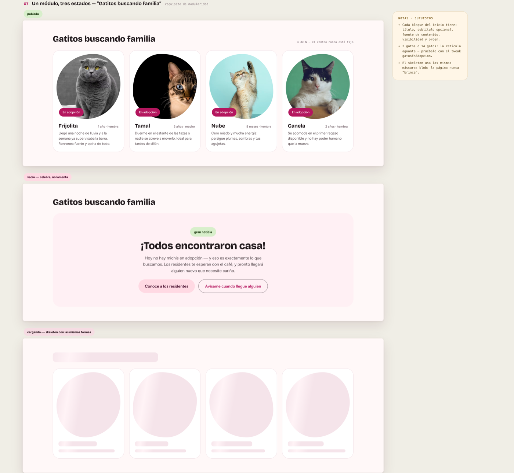
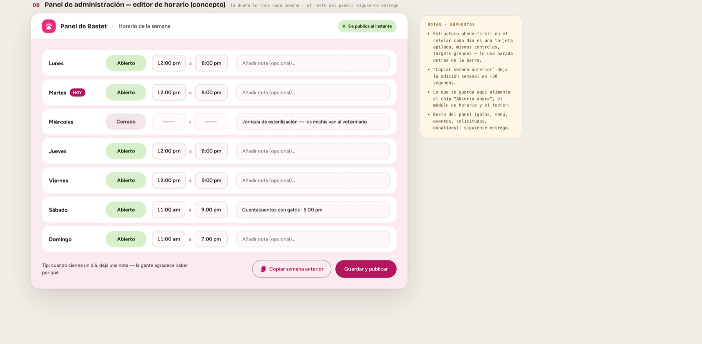

# Bastet Cat Café — sitio web

> [!WARNING]
> **🚧 Trabajo en progreso — nada de esto es final.**
> Este repo contiene **un prototipo de diseño y notas de descubrimiento**, no un sitio en producción.
> Todavía no hay decisiones cerradas con el cliente: el contenido, los precios, los gatos, el horario
> y hasta el orden del menú de navegación son **placeholder**. No lo compartas como si fuera el sitio real.

Café de especialidad y refugio felino en Tijuana. Fundado por Elizabeth Barajas.
El objetivo del proyecto es un sitio que sirva para tres cosas a la vez: **el café**, **la adopción de gatitos**
y **las campañas de concientización** que quieren empezar a hacer.



---

## Estado actual

| | |
|---|---|
| **Fase** | Pase 1 · concepto visual |
| **Qué existe** | Prototipo de diseño navegable (`index.html`) + notas de la reunión 1 |
| **Qué NO existe** | Código de producción, backend, CMS, dominio, hosting, contenido real |
| **Última entrega** | Agosto 2026 |
| **Siguiente** | Confirmar con el cliente el orden de pestañas y el contenido real |

El prototipo está hecho a **1440 px, solo escritorio**, sobre **Material 3 Expressive**.
Las versiones móvil/tablet y el modo oscuro **no entran en este pase**.

---

## Cómo verlo

`index.html` es un solo archivo de ~3 MB. Necesita servirse por HTTP:

```bash
python3 -m http.server 8899
```

Luego abre <http://localhost:8899/index.html>.

**Ábrelo con internet.** Las fuentes sí van embebidas, pero las fotos de los gatos todavía se piden a
Unsplash en tiempo de carga: sin red el prototipo navega bien pero las fichas salen sin foto. Si lo vas a
enseñar en una reunión, cárgalo antes para que quede en caché.

Ojo: **el prototipo es interactivo**. Los filtros de la página de gatitos funcionan de verdad, y hay tres
"tweaks" para probar estados — cuántos gatos hay en adopción (0 a 7), si el café está abierto o cerrado, y
si se ven las notas ámbar. En el archivo exportado no hay panel para moverlos; se editan a mano o desde el
lienzo. Cómo hacerlo, en la [nota técnica](docs/prototipo.md).

---

## El diseño, sección por sección

El documento tiene 8 secciones. Cada una lleva al lado una columna ámbar de **notas y supuestos** —
ahí está marcado explícitamente qué es invento mío y qué falta confirmar con el cliente.

### 01 · Fundaciones (style tile)

Paleta, tipografía, forma, componentes y las tres únicas animaciones del sitio.



- **Color:** roles M3 derivados de `#EC2A7B`. ⚠️ Ese rosa es un **stand-in**: hay que muestrear el hex del
  logo real y regenerar la paleta (es un solo cambio).
- **Tipografía:** [Bricolage Grotesque](https://fonts.google.com/specimen/Bricolage+Grotesque) para títulos +
  [Figtree](https://fonts.google.com/specimen/Figtree) para cuerpo. Ambas de Google Fonts, gratis y variables.
- **Superficies:** blancos entintados de rosa (`#FFF8F8` → `#EFDEE4`), nada de gris. On-surface espresso-ciruela
  `#221A1D`, nunca negro puro.
- **Accesibilidad:** contraste AA (cuerpo ≥4.5:1, UI ≥3:1), foco visible, targets ≥48dp, `prefers-reduced-motion`
  respetado.

### 02 · Inicio — página completa

10 módulos que la dueña puede editar, ocultar y reordenar desde su celular: hero, gatitos buscando familia,
"¿primera vez en un cat café?", horario de la semana, del menú, apadrina, lo que necesitamos este mes,
próximos eventos, nosotros y footer.

<details>
<summary>Ver la página completa (imagen larga)</summary>



</details>

- El chip **"Abierto ahora"** se calcula en vivo desde el horario semanal que se edita en el panel.
- Nada del layout depende de una cantidad fija de gatos.

### 03 · Menú (solo lectura, Fase 1)



Es a donde aterriza el QR de la mesa. **Sin carrito y sin pedidos en Fase 1.** Los ítems sin foto se ven bien
a propósito: la dueña no siempre va a tener foto de todo. Precios en MXN, inventados.

### 04 · Kiosko en recepción (concepto, Fase 2)



⚠️ **No aprobado.** Está aquí nada más para que la dueña vea hasta dónde puede llegar esto.
iPad 11″ horizontal, de pie a ~1 m, targets ≥64dp y tipografía +25%. Supuesto: se paga en barra.

### 05 · Gatitos — índice con filtros



Los filtros (edad, sexo, convivencia, estado) **funcionan en el prototipo**. Tres estados de gato que nunca se
aplanan en uno solo: **en adopción / residente de casa / en tratamiento**. 10 gatos placeholder con historias
inventadas y fotos de Unsplash: 7 en adopción, 2 residentes de casa y 1 en tratamiento.

### 06 · Perfil de gato



Ficha individual con checklist médico (vacunas / esterilización / desparasitación) y el resumen del proceso de
adopción en 4 pasos. El **formulario multi-paso** real (progreso, guardar y continuar, tracker de estado) se
diseña en la siguiente entrega. WhatsApp se queda como vía paralela, no se elimina.

### 07 · Un módulo, tres estados



Demostración del requisito de modularidad: el mismo bloque con contenido, en carga (skeleton) y vacío.
Con 0 gatos en adopción el módulo **celebra** en vez de verse roto.

### 08 · Panel de administración — editor de horario



La única parte del panel diseñada hasta ahora, porque es la que la dueña toca cada semana. Estructura
phone-first: parada detrás de la barra, cada día es una tarjeta apilada. "Copiar semana anterior" deja la
edición en ~30 segundos. El resto del panel (gatos, menú, eventos, solicitudes, donativos) va en la
siguiente entrega.

---

## Lo que sabemos del cliente

Resumen de [`meetings/meeting-01.md`](meetings/meeting-01.md) — ahí están las notas completas.

**Requisitos de adopción:** identificación oficial, comprobante de domicilio, formato lleno, entrevista,
transportadora y cuota de recuperación de $800 MXN (cubre vacunas, esterilización, desparasitación y baños).

**Proceso:** entrevista de 30–40 min con preguntas de filtro; si aprueban, el gato se puede ir el mismo día,
con hasta una semana de gracia para completar requisitos. Después hay seguimiento: semanal al principio,
luego mensual, luego cada 2–3 meses.

**Equipo:** 6 personas. Elizabeth y Angie a cargo, 2 chefs y 2 personas dedicadas al cuidado de los gatos.

**Meta de la fundadora:** llegar a **10,000 adopciones**. Van recién pasando las 2,000.

**Concientización:** quieren ampliar sus campañas hacia el sitio, redes y escuelas primarias y secundarias.
Los temas: abandono y esterilización, y datos concretos (a los 4 meses una gatita ya puede quedar embarazada,
y al mes de parir otra vez, con camadas de 3 a 6 gatitos), además de los riesgos de la vida en la calle.

---

## Pendientes y preguntas abiertas

- [ ] **Orden de las pestañas** — fue el único comentario que hicieron en la reunión 1. Falta pedirles el orden que quieren.
- [ ] **Pestaña de concientización** — propuesta mía, todavía no la ven. Sería la sección que hace que Bastet sea más que "un café con gatos".
- [ ] **Logo real** → muestrear el hex y regenerar la paleta.
- [ ] **Fotos reales** de la dueña en lugar de Unsplash (las máscaras blob perdonan fotos de celular movidas).
- [ ] **Contenido real:** menú y precios, horario, gatos, eventos, necesidades del mes, tiers de apadrinamiento.
- [ ] **Dirección y teléfono reales** (los del prototipo son falsos a propósito).
- [ ] Confirmar: ¿hay costo de entrada o reservación?
- [ ] Confirmar: ¿WhatsApp se queda como vía paralela de adopción?
- [ ] Confirmar: el compromiso de "te respondemos en 3 días" — que lo ponga la dueña.
- [ ] Definir stack, hosting y dominio. Nada de esto está decidido.

### Ideas mencionadas, sin comprometer

- **Stream en vivo de los gatitos.** Primero podría ser interno, para cuidarlos en días sin operación; después,
  quizá público para clientes y visitantes.
- **Kiosko de pedidos en recepción** (sección 04) — concepto, no aprobado.

---

## Estructura del repo

```
.
├── index.html              # prototipo de diseño, archivo único (~3 MB)
├── docs/
│   ├── prototipo.md        # nota técnica del archivo: tweaks, datos, qué va embebido
│   └── screenshots/        # capturas del prototipo, usadas en este README
├── meetings/
│   └── meeting-01.md       # notas de la primera reunión con el cliente
└── README.md
```

---

## Aviso

Todo el contenido visible en el prototipo — gatos, nombres, historias, precios, horarios, eventos,
necesidades del mes, tiers, dirección y teléfono — es **placeholder inventado**. Las fotos son de Unsplash
(licencia libre) y se reemplazan con fotos del café. Nada aquí representa información oficial de
Bastet Cat Café todavía.
